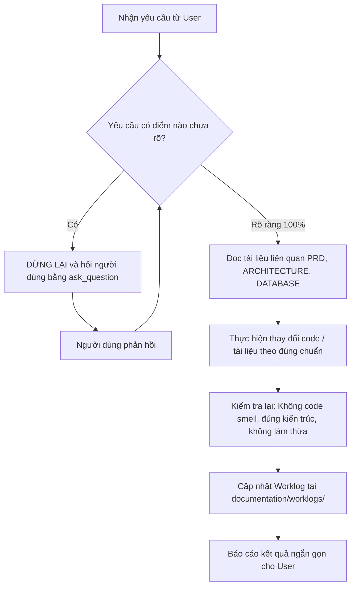

# Quy tắc và Hướng dẫn dành cho AI Agents (AGENTS.md)

Tài liệu này là quy chuẩn bắt buộc áp dụng cho mọi AI Agent (và các subagent) khi tham gia đọc, thiết kế, triển khai mã nguồn, hoặc cập nhật tài liệu trong dự án **Football Booking MVP**.

---

## 1. Nguyên tắc cốt lõi (Core Operating Principles)

1. **Chính xác, không làm thừa thãi, không làm bừa**:
   - Chỉ thực hiện chính xác những gì người dùng yêu cầu trong phạm vi của task.
   - **Khi chưa chắc chắn hoặc yêu cầu chưa rõ ràng: BẮT BUỘC PHẢI HỎI LẠI NGƯỜI DÙNG.** Không tự ý suy diễn hoặc giả định các quyết định nghiệp vụ/kiến trúc quan trọng.
2. **Nghiêm cấm Code Smell**:
   - Viết code sạch, dễ đọc, tuân thủ SOLID, DRY, KISS, YAGNI.
   - Đặt tên biến, hàm, class rõ nghĩa, thể hiện đúng bản chất domain. Không viết hàm quá dài (hạn chế trên 40-50 dòng), không lồng ghép `if/else` quá sâu.
   - Xử lý lỗi tường minh; tuyệt đối không nuốt lỗi (`catch` rỗng). Sử dụng đúng mã lỗi HTTP và format lỗi đã quy định trong `documentation/api/openapi.yaml`.
3. **Liên tục cập nhật Worklog**:
   - Sau mỗi công việc hoàn thành hoặc trước khi kết thúc một phiên làm việc, **phải cập nhật hoặc tạo file worklog** trong thư mục `documentation/worklogs/` theo quy chuẩn tại [documentation/worklogs/README.md](documentation/worklogs/README.md).
4. **Bảo toàn tài liệu và mã nguồn hiện có**:
   - Không tự ý xóa bỏ các comment, docstring, file tài liệu hoặc cấu hình sẵn có nếu không liên quan đến phạm vi công việc được giao.

---

## 2. Kiến trúc bắt buộc phải tuân theo (Architectural Guidelines)

Chi tiết kiến trúc được quy định tại [documentation/architecture/ARCHITECTURE.md](documentation/architecture/ARCHITECTURE.md) và [documentation/architecture/DATABASE.md](documentation/architecture/DATABASE.md). Mọi mã nguồn backend phải tuân thủ nghiêm ngặt:

### 2.1. Mô hình tổng thể: Modular Monolith
- Backend dùng **NestJS** chia thành 7 modules nghiệp vụ độc lập trong `src/modules/`:
  - `auth/`: Đăng ký, đăng nhập, JWT.
  - `users/`: Quản lý tài khoản, profile cá nhân, quản trị viên (Admin).
  - `venues/`: Quản lý Cụm sân (`Venue`) và các Sân con (`Court`).
  - `bookings/`: Đặt sân, hủy sân, truy vấn lịch đặt.
  - `staffing/`: Tuyển dụng, nộp đơn ứng tuyển, phê duyệt bổ nhiệm và thu hồi quyền Manager.
  - `feedback/`: Đánh giá, góp ý cho Venue.
  - `notifications/`: Hàng đợi gửi thông báo (Outbox pattern).
- Không được để module này gọi trực tiếp Repository nội bộ của module khác. Giao tiếp liên module phải thông qua **Service công khai** (Exported Services).

### 2.2. Phân tầng 4 lớp bên trong từng Module (Clean / Layered Architecture)
Mỗi module backend bắt buộc phải tổ chức thành 4 tầng rõ rệt:

```text
src/modules/<module-name>/
  <module-name>.module.ts
  presentation/       # Controller & DTO
  application/        # Service (Use Cases)
  domain/             # Entities, Business Rules, Repository Interfaces
  infrastructure/     # Prisma Repository Implementations
```

- **presentation/**:
  - Chỉ nhận HTTP Request, validate input qua DTO (Class-Validator), gọi Service và trả về Response.
  - **Tuyệt đối KHÔNG** gọi trực tiếp Repository hoặc Prisma Client.
- **application/**:
  - Điều phối luồng nghiệp vụ (Use Case), kiểm tra quyền thao tác trên dữ liệu cụ thể, quản lý transaction.
  - **Tuyệt đối KHÔNG** nhận đối tượng HTTP (`req`, `res`) và **KHÔNG** viết truy vấn raw Prisma tại đây.
- **domain/**:
  - Chứa Domain Entities, Business Rules và Repository Interfaces (ví dụ: `IBookingRepository`).
  - **Phải là TypeScript thuần túy (POJO)**. Tuyệt đối KHÔNG import NestJS, Prisma hay bất kỳ thư viện hạ tầng bên ngoài nào vào `domain/`.
- **infrastructure/**:
  - Triển khai (implement) các Repository Interfaces định nghĩa từ tầng Domain bằng Prisma.
  - Sử dụng **Dependency Inversion (DIP)**: Khai báo Custom Provider trong NestJS Module qua Token `Symbol('..._REPOSITORY')` để inject vào Service.

---

## 3. Các quy tắc nghiệp vụ & Kỹ thuật then chốt

1. **Phân quyền động (Dynamic RBAC)**:
   - Manager **không phải là một role tĩnh trong token**. Quyền quản lý Venue được xác định thông qua bản ghi hiệu lực trong bảng `manager_appointments` (`revoked_at IS NULL`).
   - Khi kiểm tra quyền tại Venue, Service **phải truy vấn trạng thái thực tế từ CSDL**, không được chỉ tin cậy vào token cũ.
2. **Quy tắc về Baseline có lỗi chủ đích (Intentional Concurrency Defect)**:
   - Dự án là đồ án môn Kiến trúc phần mềm: Bản **Baseline** cố tình không có khóa và không có DB exclusion constraint ở luồng tạo booking để tái hiện lỗi **Race Condition (đặt trùng sân)**.
   - **Agent KHÔNG ĐƯỢC tự ý sửa lỗi này trên nhánh baseline.** Lỗi này chỉ được xử lý ở bản Cải tiến và phải được kiểm chứng bằng benchmark đo lường.
3. **Múi giờ & Thời gian**:
   - Toàn bộ kết nối PostgreSQL và Prisma phải chạy ở chế độ **UTC** (`options: '-c TimeZone=UTC'`).
   - Cột thời gian luôn dùng `timestamptz`.
4. **Xóa mềm (Soft Delete)**:
   - `accounts`, `venues`, `courts` dùng xóa logic qua `deleted_at`. Lịch sử booking và bổ nhiệm luôn được giữ nguyên.
5. **Đồng bộ với OpenAPI**:
   - Mọi thay đổi về API endpoint, request body, response schema hoặc status code phải được cập nhật đồng bộ trong `documentation/api/openapi.yaml`.

---

## 4. Quy tắc Git & Đặt tên nhánh (Branching)

- **Không bao giờ đặt tên nhánh local có tiền tố `origin/`** (ví dụ: `origin/hieu` là sai).
- Đặt tên nhánh theo chuẩn:
  - `feat/<ten-chuc-nang>` hoặc `feature/<ten-chuc-nang>`
  - `fix/<ten-loi>`
  - `docs/<noi-dung-tai-lieu>`
- Commit message phải ngắn gọn, rõ ràng, nêu đúng bản chất thay đổi.

---

## 5. Quy trình làm việc khi nhận Task (Task Workflow)


