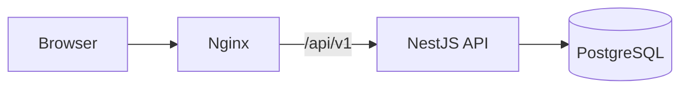

# Hệ thống đặt sân bóng đá Pitchly (MVP)

Dự án phát triển hệ thống đặt và quản lý sân bóng đá phong trào, phục vụ cho đồ án môn **Kiến trúc Phần mềm**.

Ứng dụng web giúp người dùng tìm sân trống và đặt sân bóng đá trực tuyến. Chủ sân (Owner) quản lý các cụm sân của mình, theo dõi lịch đặt và tuyển, bổ nhiệm người quản lý (Manager) cho từng cụm sân. Quản trị viên (Admin) quản lý tài khoản trong hệ thống.

---

## 1. Bài toán và nghiệp vụ

### Vai trò

| Vai trò | Làm được gì |
| --- | --- |
| User | Đặt, hủy sân; gửi feedback; ứng tuyển Manager. |
| Owner | Quản lý Venue của mình; bổ nhiệm, thu hồi Manager. |
| Manager | User được bổ nhiệm; quản lý Court và booking tại Venue được giao. |
| Admin | Khóa, mở khóa, xóa tài khoản. |

Manager không phải loại tài khoản riêng. Đó là quyền gắn với từng Venue, có thể bị thu hồi.

### Quy tắc nghiệp vụ chính

- **Đặt sân**: xác nhận ngay, mỗi lượt từ 30 phút đến 4 giờ, không trùng giờ trên cùng một Court.
- **Hủy sân**: User hủy trước giờ đá ít nhất 30 phút. Owner/Manager hủy booking của khách phải ghi lý do.
- **Manager**: mỗi Venue tối đa một Manager, một Manager được quản lý nhiều Venue.
- **Xóa**: chỉ xóa logic để giữ lịch sử.

Chi tiết xem [PRD](documentation/product/PRD.md).

---

## 2. Kiến trúc

### Tech stack

| Thành phần | Công nghệ |
| --- | --- |
| Frontend | React 18, Vite, TypeScript, Tailwind CSS |
| Backend | NestJS 10, TypeScript, REST API |
| Database | PostgreSQL 17, Prisma 7 |
| Xác thực | JWT |
| Triển khai | Docker Compose, Nginx |

### Tổng thể

Backend là một **Modular Monolith**: một ứng dụng duy nhất, chia thành 7 module nghiệp vụ, dùng chung một PostgreSQL. Nginx phục vụ giao diện và chuyển các request `/api/v1` sang backend.



| Module | Phụ trách |
| --- | --- |
| `auth` | Đăng ký, đăng nhập, JWT |
| `users` | Tài khoản, profile, quản trị |
| `venues` | Venue và Court |
| `bookings` | Đặt, hủy, xem booking |
| `staffing` | Tuyển, bổ nhiệm, thu hồi Manager |
| `feedback` | Góp ý cho Venue |
| `notifications` | Thông báo cho người dùng |

Các module chỉ gọi nhau qua Service công khai, không dùng trực tiếp Repository của module khác.

### Phân tầng trong mỗi module

```text
presentation/    Controller, DTO: nhận request, validate, trả response
application/     Service: điều phối nghiệp vụ, kiểm tra quyền, transaction
domain/          Entity, quy tắc nghiệp vụ, interface Repository (TypeScript thuần)
infrastructure/  Repository triển khai bằng Prisma
```

Luồng xử lý: **Controller → Service → Repository → PostgreSQL**. Service phụ thuộc vào interface Repository chứ không phụ thuộc Prisma.

Chi tiết xem [Kiến trúc](documentation/architecture/ARCHITECTURE.md) và [Thiết kế database](documentation/architecture/DATABASE.md).

---

## 3. Baseline và lỗi chủ đích

Bản **Baseline** vẫn giữ đúng phân tầng, nhưng cố tình bỏ qua một số cơ chế đồng bộ, tối ưu và kiểm soát tải. Mục đích là tạo mốc để đo và so sánh với các bản cải tiến.

| Mã | Vấn đề | Hậu quả |
| --- | --- | --- |
| HOOK-01 | Không khóa khi đặt sân đồng thời | Đặt trùng sân (race condition) |
| HOOK-02 | Truy vấn N+1 khi lấy danh sách Venue | Chậm dần khi dữ liệu tăng |
| HOOK-03 | Gửi thông báo đồng bộ trong request | Hủy sân, bổ nhiệm chậm thêm gần 1 giây |
| HOOK-04 | Kiểm tra quyền Manager truy vấn DB mỗi request, không cache | Tải DB cao, giảm thông lượng |
| HOOK-05 | Không giới hạn tần suất ở endpoint công khai | Dễ bị brute-force đăng nhập, spam |


Cách tái hiện và hướng khắc phục từng lỗi: xem [Kiến trúc](documentation/architecture/ARCHITECTURE.md#baseline-có-lỗi-chủ-đích-intentional-defect-hooks).

---

## 4. Chạy dự án

### Yêu cầu

- Docker và Docker Compose
- Node.js 20.6 trở lên, nếu chạy dev không qua Docker

### Chạy bằng Docker

1. Tạo file `.env` từ file mẫu:

   ```bash
   cp .env.example .env
   ```

   Đổi `POSTGRES_PASSWORD`, `SEED_PASSWORD`, `JWT_SECRET`. Mật khẩu trong `DATABASE_URL` phải trùng với `POSTGRES_PASSWORD`.

2. Build và chạy:

   ```bash
   docker compose up -d --build
   ```

   Lệnh này dựng PostgreSQL, tự chạy migration và nạp dữ liệu mẫu, rồi khởi động backend và frontend.

| Dịch vụ | Địa chỉ |
| --- | --- |
| Web | http://localhost |
| API | http://localhost:3000/api/v1 |
| Swagger | http://localhost:3000/api/docs |
| PostgreSQL | `localhost:5432` |

### Tài khoản mẫu

Mật khẩu của mọi tài khoản mẫu là giá trị `SEED_PASSWORD` trong `.env`.

| Vai trò | Email đăng nhập | Mô tả & Quyền hạn |
| :--- | :--- | :--- |
| **Admin** | `admin@example.com` | Quản trị viên hệ thống (quản lý, khóa/mở khóa tài khoản). |
| **Owner** | `owner.anphu@example.com` | Chủ sở hữu Sân An Phú và Sân Thảo Điền. |
| **Owner** | `owner.thuduc@example.com` | Chủ sở hữu Sân Thủ Đức. |
| **Manager** | `manager.minh@example.com` | Quản lý đương nhiệm tại Sân An Phú. |
| **User** | `user.lan@example.com` | Khách đặt sân; đã nộp hồ sơ ứng tuyển làm quản lý Sân An Phú. |
| **User** | `user.huy@example.com` | Khách đặt sân; cựu quản lý Sân Thảo Điền (đã bị thu hồi quyền). |

Danh sách đầy đủ xem [Thiết kế database](documentation/architecture/DATABASE.md#triển-khai).

<details>
<summary>Chạy dev không qua Docker</summary>

Chỉ chạy database bằng Docker:

```bash
docker compose up -d postgres db-init
```

Backend, tại thư mục gốc:

```bash
npm install
npm run db:generate
npm run build
node --env-file=.env dist/main
```

Frontend, mở terminal khác:

```bash
cd frontend
npm install
npm run dev
```

Mở http://localhost:5173. Vite tự chuyển các request `/api/v1` sang backend ở cổng 3000.

Các lệnh database: `npm run db:migrate` (tạo migration mới), `npm run db:seed`, `npm run db:reset`, `npm run db:studio`.

</details>

---

## 5. API

Backend cung cấp REST API, tiền tố chung là `/api/v1`. Có hai cách xem tài liệu API:

| | Swagger online | Swagger local |
| --- | --- | --- |
| Địa chỉ | [Mở Swagger](https://huuhieu03.github.io/sports-court-booking-system/) | http://localhost:3000/api/docs |
| Nguồn | `documentation/api/openapi.yaml` | Sinh tự động từ code backend |
| Gửi request thử | Không | Có, khi dự án đang chạy |

**Gọi thử API cần đăng nhập** trên Swagger local:

1. Gọi `POST /api/v1/auth/login` bằng một [tài khoản mẫu](#tài-khoản-mẫu).
2. Copy `accessToken` trong response.
3. Bấm **Authorize**, dán token vào rồi xác nhận.

**Khi sửa API**, phải cập nhật [`openapi.yaml`](documentation/api/openapi.yaml), vì đây là đặc tả chuẩn của dự án. Swagger online sẽ tự xuất bản lại khi file này được push lên `main`.

---

## 6. Cấu trúc thư mục

```text
.
├── src/                    # Backend NestJS
│   ├── modules/            # 7 module nghiệp vụ, mỗi module chia 4 tầng
│   │   └── bookings/
│   │       ├── presentation/
│   │       ├── application/
│   │       ├── domain/
│   │       └── infrastructure/
│   ├── common/             # Guard, filter, decorator, pipe, Prisma dùng chung
│   └── main.ts
├── frontend/               # Frontend React + Vite
│   └── src/
│       ├── modules/        # Giao diện theo nghiệp vụ, tương ứng module backend
│       ├── components/     # Component dùng chung
│       ├── pages/
│       └── lib/            # API client, tiện ích
├── prisma/                 # Schema, migration, dữ liệu mẫu
├── docker/                 # Cấu hình Nginx, image chạy migration và seed
├── test/                   # Test nghiệp vụ và test tái hiện race condition
├── scripts/                # Script kiểm tra kiến trúc và độ phủ OpenAPI
├── documentation/          # PRD, kiến trúc, database, OpenAPI, worklog
├── docker-compose.yml
└── Dockerfile              # Build cả backend và frontend
```

---

## 7. Tài liệu

| Tài liệu | Nội dung |
| --- | --- |
| [PRD](documentation/product/PRD.md) | Phạm vi MVP, use case, phân quyền, quy tắc nghiệp vụ |
| [Kiến trúc](documentation/architecture/ARCHITECTURE.md) | Tech stack, module, phân tầng, các lỗi chủ đích của Baseline |
| [Thiết kế database](documentation/architecture/DATABASE.md) | ERD, ràng buộc, migration, dữ liệu mẫu |
| [OpenAPI](documentation/api/openapi.yaml) | Endpoint, request, response, mã lỗi |
| [Worklog](documentation/worklogs/README.md) | Công việc đã làm, kết quả kiểm tra, vướng mắc |
| [AGENTS.md](AGENTS.md) | Quy tắc bắt buộc khi dùng AI agent trong dự án |

Hướng dẫn đọc và cập nhật tài liệu xem [documentation/README.md](documentation/README.md).
