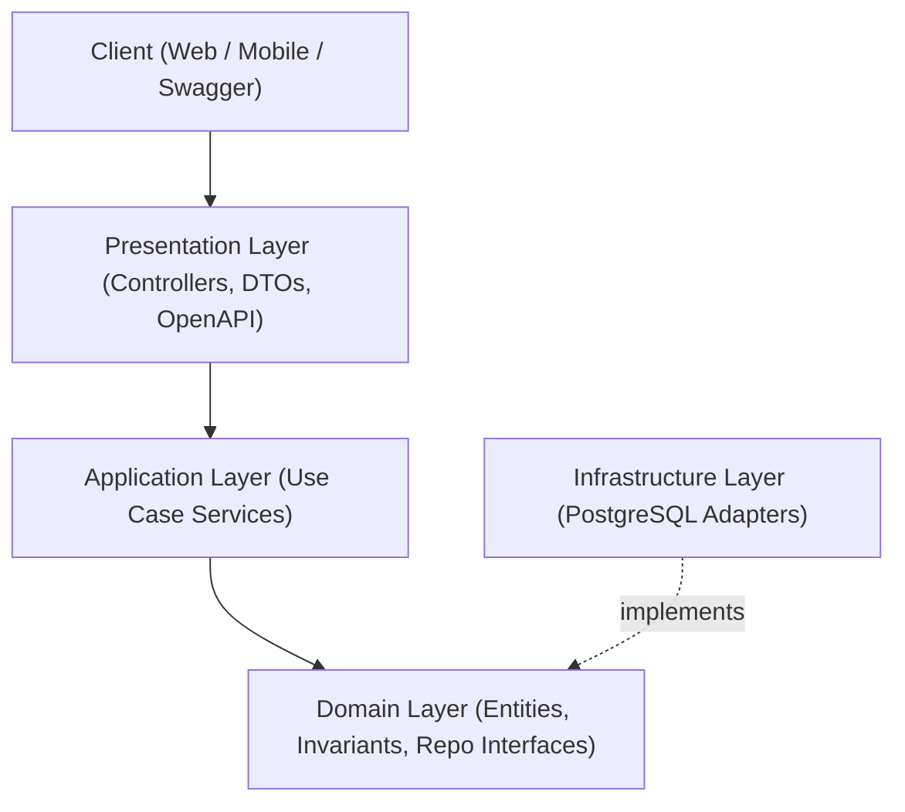

# Sports Court Booking System

A university Software Architecture project implementing a modern, multi-facility court reservation backend using **NestJS**, **TypeScript**, and a **Modular Monolith Layered Architecture**.

---

## 1. Project Overview & Problem Domain

The **Sports Court Booking System** addresses operational challenges faced by sports facility operators (badminton, tennis, pickleball, football) and players. It automates court inventory management, provides real-time slot availability, eliminates scheduling conflicts (double-booking), and secures customer access.

### Course Context
- **Phase 1 (Foundational Delivery):** Build a compliant backend service with REST APIs (POST, GET, DELETE), OpenAPI/Swagger documentation, JWT authentication with framework guards, clean layered separation, Repository Pattern, and Docker containerization.
- **Phase 2 (Architectural Improvement):** Introduce performance and scalability architectural improvements supported by reproducible before/after load benchmarks executed on a single fixed **Kaggle CPU environment**.

---

## 2. Current Implementation Status

| Capability / Module | Architectural Layer | Current Status | Notes |
| :--- | :--- | :--- | :--- |
| **Scaffolding & DX** | Repository & Tooling | **Completed** | Full repository structure, CI workflow, metadata validator, workspace bootstrapper |
| **Documentation Knowledge Base** | `documentation/` | **Completed** | 11 specialized directories, schemas, templates, ADR-0001, draft specs |
| **Health Check Service** | `common/health` | **Implemented** | `GET /api/v1/health` operational with uptime, status, and version |
| **Auth Module** | `src/modules/auth` | Scaffolding Ready | Domain interfaces defined; JWT and guards planned for Phase 1 |
| **Users Module** | `src/modules/users` | Scaffolding Ready | Pure domain entity & repository interface ready; persistence planned |
| **Venues Module** | `src/modules/venues` | Scaffolding Ready | Entity & repository interface ready; CRUD planned for Phase 1 |
| **Courts Module** | `src/modules/courts` | Scaffolding Ready | Entity & repository interface ready; inventory management planned |
| **Bookings Module** | `src/modules/bookings` | Scaffolding Ready | Entity & repository interface ready; conflict detection planned |
| **PostgreSQL Persistence** | `infrastructure/` | Configured | Docker Compose configured; migrations & ORM planned for Phase 1 |

---

## 3. Chosen Architecture

We adopt a **Modular Monolith with Layered Architecture** ([ADR-0001](documentation/03_architecture/v1.0.0-2026-10-15-adr-0001-modular-monolith-layered-architecture.md)).



### Strict Architectural Invariants
1. **Zero Framework Pollution in Domain:** `domain/` contains pure TypeScript. It **never** imports `@nestjs/*`, `express`, `@prisma/client`, `typeorm`, or database drivers.
2. **Repository Pattern:** Application services depend solely on domain repository interfaces (`I<Name>Repository`), making persistence fully swappable.
3. **No Controller Database Queries:** Controllers only delegate to application services.

---

## 4. Repository Structure

```text
.
├── .github/              # CI workflows and PR templates
├── benchmarks/           # Load-testing configurations and benchmark scripts
├── documentation/        # Official team knowledge base (version-controlled)
│   ├── 00_governance/    # Metadata schemas, conventions, and lifecycle
│   ├── 01_product/       # Problem statement, personas, and scope
│   ├── 02_requirements/  # Functional & non-functional requirements
│   ├── 03_architecture/  # Architecture overview and ADRs (ADR-0001)
│   ├── 04_api/           # REST endpoints, DTO contracts, and guidelines
│   ├── 05_development/   # Phase 1 implementation roadmap and plans
│   ├── 06_testing/       # Testing strategy and pyramid
│   ├── 07_meetings/      # Team meeting minutes and action items
│   ├── 08_benchmarks/    # Kaggle CPU benchmark environment and reports
│   ├── 09_reports/       # Course milestone submissions
│   └── 99_archive/       # Superseded documentation
├── frontend/             # React + TypeScript frontend client shell (scaffold)
├── my_workspace/         # Personal developer workspace (STRICTLY IGNORED by Git)
├── scaffolds/            # Tracked templates used to bootstrap my_workspace/
├── scripts/              # Workspace initialization and documentation validation scripts
├── src/                  # NestJS source code (Modular Monolith)
│   ├── common/           # Shared filters, interceptors, and health module
│   └── modules/          # Feature modules (auth, users, venues, courts, bookings)
├── test/                 # End-to-end test suites
├── Dockerfile            # Multi-stage production container build
├── compose.yaml          # Local development orchestration (App + PostgreSQL)
├── package.json          # Node.js project manifest & scripts
└── tsconfig.json         # TypeScript configuration with path aliases
```

---

## 5. Getting Started & Local Setup

### Prerequisites
- Node.js LTS (v20.x, specified in `.nvmrc`)
- npm (v10.x+)
- Docker & Docker Compose (optional, for containerized run)
- Python environment note: If any Python tools are ever required, use `uv` and create a `.venv` (see `.gitignore`).

### 1. Clone & Install Dependencies
```bash
git clone <repository-url>
cd "Software architecture"
npm install
```

### 2. Initialize Your Private Developer Workspace
To set up your local, Git-ignored `my_workspace/` for private research, notes, and agent sessions:
```bash
npm run workspace:init
```
*Note: This command is idempotent and will never overwrite existing personal notes.*

### 3. Run the Development Server
```bash
npm run start:dev
```
- API Base URL: `http://localhost:3000/api/v1`
- Service Health Check: `http://localhost:3000/api/v1/health`
- Interactive Swagger OpenAPI Docs: `http://localhost:3000/api/docs`

### 4. Running with Docker Compose
To run both the application and PostgreSQL in containers:
```bash
docker compose up --build
```

---

## 6. Development & Testing Commands

| Command | Description |
| :--- | :--- |
| `npm run build` | Compiles TypeScript and builds production output in `dist/` |
| `npm run start:dev` | Starts application with hot-reload watch mode |
| `npm test` | Runs Jest unit tests |
| `npm run test:cov` | Runs Jest unit tests with code coverage report |
| `npm run test:e2e` | Runs Supertest end-to-end API tests |
| `npm run docs:validate`| Validates YAML Front Matter metadata across documentation |
| `npm run workspace:init`| Initializes or repairs local `my_workspace/` from scaffold |

---

## 7. AI Coding Agent & Team Guidelines
- For AI agent collaboration rules, boundary invariants, and session logging, read [`AGENTS.md`](AGENTS.md).
- For branch naming, Conventional Commits, and PR review checklists, read [`CONTRIBUTING.md`](CONTRIBUTING.md).
- For document authoring, metadata schema, and lifecycle rules, see [`documentation/00_governance/`](documentation/00_governance/README.md).
