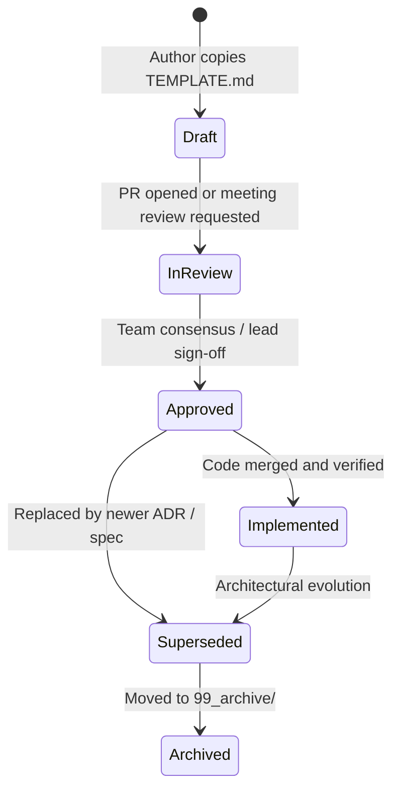

# Documentation Lifecycle & Promotion Workflow

## 1. Document States & Transitions

- **Draft (`status: draft`)**: Early working document. May contain unresolved questions, assumptions, and preliminary code sketches.
- **In-Review (`status: in-review`)**: Proposed changes under active review by team members.
- **Approved (`status: approved`)**: Formally accepted policy, ADR, or specification. Serves as the authoritative constraint for implementation.
- **Implemented (`status: implemented`)**: The software artifact has been built, tested, and verified to match the approved design.
- **Superseded (`status: superseded`)**: Replaced by a subsequent design decision or requirement change.
- **Archived (`status: archived`)**: Moved to `99_archive/` for historical reference.

## 2. Promoting Personal Notes to Official Team Documentation

Personal drafts in `my_workspace/05_drafts/` are NOT official team decisions until promoted through this workflow:

1. **Self-Review & Polish**: Ensure the document adheres to the structure in the target folder's `TEMPLATE.md`.
2. **Move & Rename**: Copy the document from `my_workspace/05_drafts/` into the appropriate subfolder in `documentation/` with standard kebab-case naming.
3. **Update Front Matter**:
   - Change `visibility: private` to `visibility: team`.
   - Update `id` to the team naming scheme (e.g. `ADR-0002-...`).
   - Assign the author and owner.
   - Set `status: in-review`.
   - Set `is_template: false`.
4. **Validation Check**: Run `npm run docs:validate`.
5. **Pull Request**: Open a Git PR for team discussion and approval.
