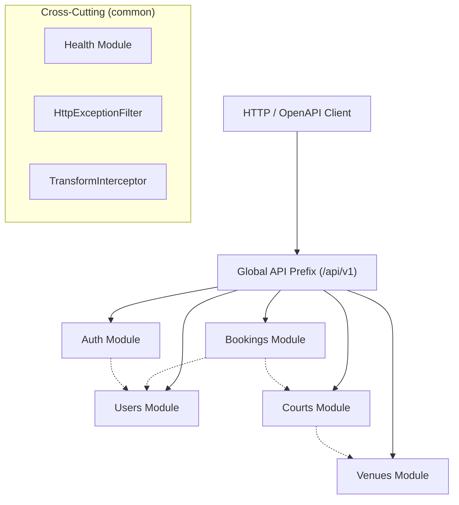
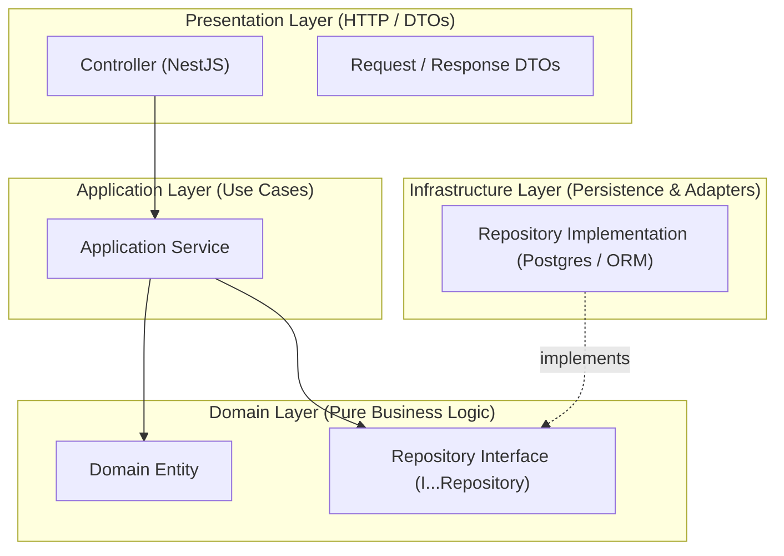

# Software Architecture Overview & Layered Design

## 1. Architectural Style: Modular Monolith

The Sports Court Booking System is designed as a **Modular Monolith** organized into distinct, domain-centric modules (`auth`, `users`, `venues`, `courts`, `bookings`) and cross-cutting capabilities (`common`).

### Rationale
- **Development Simplicity**: Single deployable runtime eliminates distributed system failure modes (network partitions, distributed transactions) while supporting clear boundaries for a university team.
- **Strict Boundaries**: Prevents spaghetti dependencies and prepares individual modules for potential extraction if required in future phases.

## 2. Layered Organization Inside Feature Modules

Every feature module conforms to four strict architectural layers:

### Layer Dependency Rules
1. **Presentation Layer**: Handles incoming HTTP requests, validates DTOs, formats responses, and handles authentication context. Delegates immediately to the Application Layer.
2. **Application Layer**: Orchestrates use cases, coordinates transactions, and enforces application workflows. It knows nothing about HTTP protocols (no `req`/`res` objects).
3. **Domain Layer (Pure TypeScript)**: Contains core domain entities and invariants (e.g. `Booking`, `Court`). **STRICT INVARIANT: MUST NOT import `@nestjs/*`, `express`, `@prisma/client`, `typeorm`, or database drivers.**
4. **Infrastructure Layer**: Implements the repository interfaces defined by the Domain Layer using database ORMs or query builders (PostgreSQL).

## 3. Data Access & Repository Pattern
To adhere to course requirements:
- Repositories are injected using NestJS dependency injection tokens (`Symbol('..._REPOSITORY')`).
- In Phase 1 development and unit testing, in-memory repository implementations can substitute for database repositories without modifying a single line of domain or application logic.

## 4. Phase 1 & Phase 2 Architecture Roadmaps
- **Phase 1 Baseline**: Direct relational storage (PostgreSQL), single-node NestJS process, basic JWT guards, Docker compose containerization.
- **Phase 2 Evolution**:
  - TODO [Phase-2]: Evaluate read-cache layer (Redis) for high-frequency queries (`GET /courts`, `GET /venues`).
  - TODO [Phase-2]: Evaluate optimistic concurrency vs database row-level locking (`SELECT ... FOR UPDATE`) to handle high-concurrency booking collisions.
  - TODO [Phase-2]: Conduct before/after load test comparison on Kaggle CPU.
