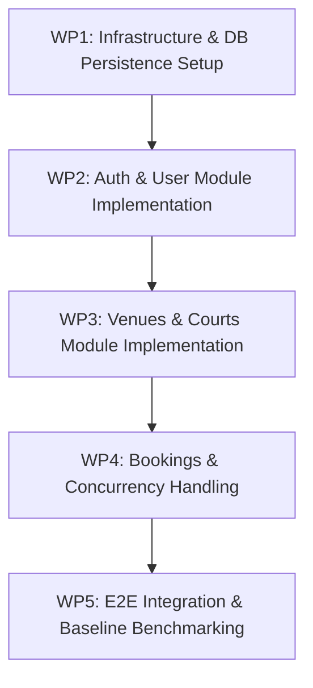

# Phase 1 Implementation Roadmap & Work Breakdown

This document defines the structured phases to implement the foundational requirements defined in the course assignment.

## Phase 1 Work Packages

### WP1: Infrastructure & DB Persistence Setup
- **Goal:** Set up PostgreSQL database connection using repository implementations in `src/modules/*/infrastructure/`.
- **Tasks:**
  - Configure PostgreSQL migration tooling (e.g., Prisma, TypeORM, or Kysely).
  - Verify that domain repository interfaces remain clean and independent.
  - Verify `docker compose up` starts database and executes migrations cleanly.

### WP2: Auth & User Module Implementation
- **Goal:** Deliver working user registration and JWT authentication.
- **Tasks:**
  - Password hashing with bcrypt.
  - JWT strategy and NestJS AuthGuard.
  - Deliver `POST /api/v1/auth/register`, `POST /api/v1/auth/login`, and `GET /api/v1/users/profile`.

### WP3: Venues & Courts Module Implementation
- **Goal:** Enable venue managers to manage facilities and court inventory.
- **Tasks:**
  - CRUD operations for venues (`POST /api/v1/venues`, `GET /api/v1/venues`, `DELETE /api/v1/venues/:id`).
  - Court inventory endpoints (`POST /api/v1/courts`, `GET /api/v1/courts`, `DELETE /api/v1/courts/:id`).

### WP4: Bookings & Concurrency Handling
- **Goal:** Implement slot reservation and double-booking prevention.
- **Tasks:**
  - Implement overlapping range check in `BookingsService`.
  - Deliver `POST /api/v1/bookings`, `GET /api/v1/bookings/:id`, `DELETE /api/v1/bookings/:id`.

### WP5: E2E Integration & Baseline Benchmarking
- **Goal:** Verify end-to-end user flows and execute baseline load testing on Kaggle CPU.
- **Tasks:**
  - Comprehensive integration test suite in `test/`.
  - Execute autocannon / k6 benchmark scripts under fixed CPU.
  - Archive baseline metrics into `documentation/08_benchmarks/`.
