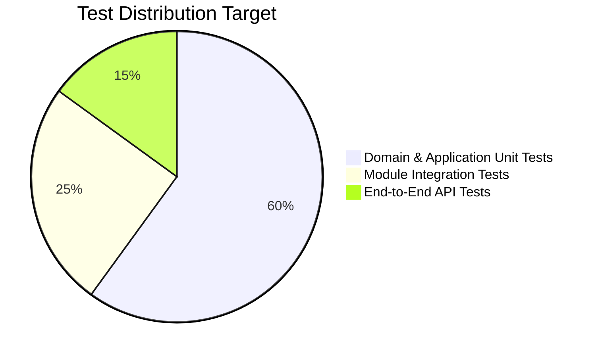

# Software Testing Strategy & Pyramid

## 1. The Testing Pyramid

1. **Domain & Application Unit Tests (60%)**:
   - Focus: Pure business invariant validation (e.g. date overlap calculation, rate calculations).
   - Speed: Sub-second execution using Jest.
   - Dependencies: Fully mocked repositories or in-memory arrays.
2. **Module Integration Tests (25%)**:
   - Focus: Verify interactions between Controllers, Application Services, and real Repository implementations.
   - Dependencies: Ephemeral SQLite or Dockerized PostgreSQL container.
3. **End-to-End (E2E) API Tests (15%)**:
   - Focus: Complete HTTP lifecycle via Supertest in `test/app.e2e-spec.ts`.
   - Verifies JWT guards, middleware, serialization, and status codes.

## 2. Directory Conventions
- Unit tests: Located adjacent to source files: `src/**/*.spec.ts`.
- E2E tests: Located in the root `test/` directory: `test/**/*.e2e-spec.ts`.
- Future benchmark load suites: Located in `benchmarks/`.

## 3. Mocking & Isolation Rules
- Domain tests MUST NEVER spin up a NestJS runtime or connect to an external database.
- Repository interfaces enable easy test doubles (`InMemoryBookingRepository`).
