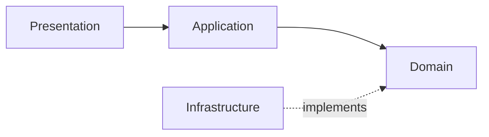

# Course Project Report: [Phase Title]

## 1. Project Objectives
<!-- What was the academic and architectural goal of this phase? -->

## 2. Project Scope & Delivered Boundaries
- **Delivered Capabilities:**
- **Exclusions / Deliberate Limitations:**

## 3. Architecture & Implementation Summary
<!-- Detailed description of the layered structure, modules, and database interactions -->

## 4. Empirical Findings & Quality Attribute Evaluation
<!-- What did the tests, benchmarks, or architectural evaluations reveal? -->

## 5. Evidence & Benchmark Data
<!-- Empirical charts, latency percentiles, memory profiling, test output -->

## 6. Limitations & Technical Debt
<!-- Constraints of the current implementation, assumptions, and known weaknesses -->

## 7. Conclusions & Next Phase Trajectory
<!-- Summary of lessons learned and immediate next steps -->
