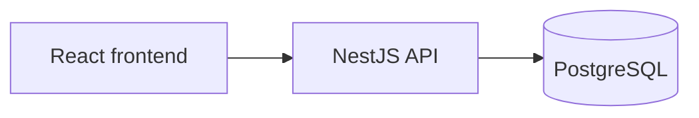
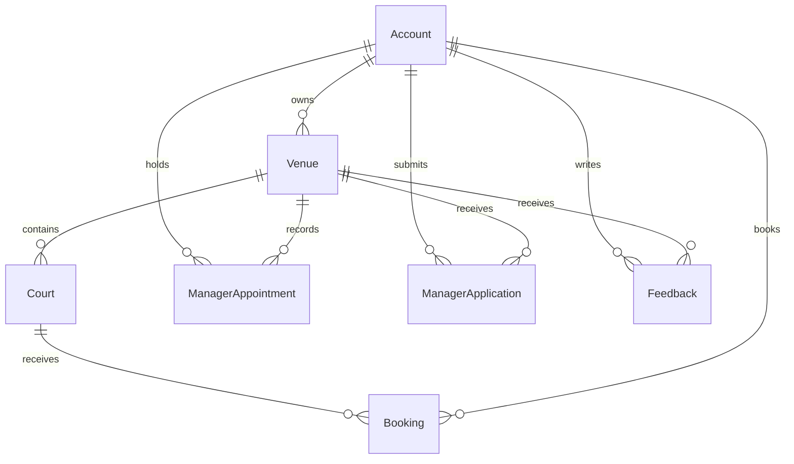

# Kiến trúc ứng dụng

Bản thiết kế, kiến trúc cho ứng dụng, các techstack được sử dụng và nội dung cần lưu ý.

## Tech stack

| Thành phần               | Công nghệ                       |
| -------------------------- | --------------------------------- |
| Frontend                   | React, Vite, TypeScript           |
| Giao diện                 | Tailwind CSS                      |
| Backend                    | NestJS, TypeScript, REST API      |
| Database                   | PostgreSQL                        |
| Truy cập dữ liệu        | Prisma và migration SQL khi cần |
| Xác thực                 | JWT                               |
| Môi trường phát triển | Docker Compose                    |

## Tổng thể

Backend dùng modular monolith: một ứng dụng, chia thành các module nghiệp vụ và dùng chung PostgreSQL. Frontend gọi backend qua REST API.



Frontend kiểm tra dữ liệu để hỗ trợ người dùng. Backend chịu trách nhiệm xác thực, phân quyền và xử lý nghiệp vụ.

## Chia module theo nghiệp vụ

```text
src/
  modules/
    auth/             Đăng nhập, xác thực JWT
    users/            Tài khoản, profile, quản trị tài khoản
    venues/           Venue và các Court thuộc Venue
    bookings/         Đặt sân, hủy sân, xem booking
    staffing/         Tuyển, ứng tuyển, bổ nhiệm và thu hồi Manager
    feedback/         Góp ý cho Venue
    notifications/    Thông báo cho người dùng
```

Role dùng để phân quyền và tách controller khi cần. Nghiệp vụ booking vẫn nằm trong `bookings`, dù người gọi là User, Owner hay Manager. Mỗi module công khai các service cần dùng cho module khác; không gọi trực tiếp Repository triển khai của nhau.

## Bên trong mỗi module

Ví dụ vị trí các file khi triển khai Booking. Khung hiện tại chỉ tạo các thư mục, chưa có file mã nguồn.

```text
bookings/
  bookings.module.ts
  presentation/
    my-bookings.controller.ts
    venue-bookings.controller.ts
    dto/
      create-booking.dto.ts
      cancel-customer-booking.dto.ts
  application/
    bookings.service.ts
  domain/
    booking.ts
    booking.repository.ts
  infrastructure/
    prisma-booking.repository.ts
```

| Phần                               | Trách nhiệm                                                                                                 |
| ----------------------------------- | ------------------------------------------------------------------------------------------------------------- |
| Controller trong `presentation`   | Nhận HTTP request, kiểm tra DTO, gọi Service và trả HTTP response.                                       |
| Service trong `application`       | Điều phối thao tác, kiểm tra quyền trên dữ liệu cụ thể, quản lý transaction và gọi Repository. |
| Domain trong `domain`             | Chứa mô hình, quy tắc nghiệp vụ và interface Repository. Dùng TypeScript thuần.                      |
| Repository trong `infrastructure` | Triển khai interface bằng Prisma, truy vấn database và chuyển đổi dữ liệu.                           |

Luồng xử lý: **Controller → Service → Repository → PostgreSQL**. Service sử dụng Domain để kiểm tra và thực hiện quy tắc nghiệp vụ.

`booking.repository.ts` khai báo `IBookingRepository`. `prisma-booking.repository.ts` triển khai interface này. `bookings.module.ts` đăng ký implementation bằng token `Symbol('BOOKING_REPOSITORY')` để NestJS inject vào Service.

- Controller không gọi Repository hoặc Prisma.
- Service không nhận Request/Response của HTTP và không viết truy vấn Prisma.
- Domain không import NestJS, Prisma hoặc thư viện hạ tầng.
- Repository không quyết định quyền truy cập và không gửi thông báo cho khách.
- Hai controller cá nhân và quản lý Venue dùng chung Service để giữ thống nhất quy tắc booking.

## Dữ liệu chính



`ManagerAppointment` lưu bổ nhiệm và lịch sử thu hồi. Một tài khoản có thể có nhiều bổ nhiệm, nhưng mỗi Venue chỉ có tối đa một Manager đang được bổ nhiệm. Manager là quyền gắn với Venue trên tài khoản, không phải một tài khoản riêng.

Venue, Court và Account dùng xóa logic. Booking và lịch sử bổ nhiệm vẫn được giữ. Thời gian booking được lưu và so sánh theo thời điểm có múi giờ.

## Các luồng cần giữ rõ

**Đặt sân.** Controller nhận Court và khung giờ. Service kiểm tra tài khoản, sân, thời gian và gọi Repository tạo booking. Yêu cầu nghiệp vụ là chỉ một booking được xác nhận khi nhiều người đặt cùng sân, cùng giờ. Baseline có lỗi chủ đích được mô tả ở phần sau.

**Phân quyền.** JWT xác định tài khoản. Backend kiểm tra trạng thái tài khoản và quan hệ sở hữu/bổ nhiệm hiện tại khi truy cập Venue. Không chỉ dựa vào role hoặc danh sách Venue đã lưu trong token. Thu hồi Manager phải chặn quyền quản lý ngay cả khi token còn hạn.

**Xem profile.** User xem chính mình. Owner/Manager xem khách thông qua booking thuộc Venue được quản lý. Chỉ Owner đúng Venue được xem liên hệ ứng viên đã đồng ý chia sẻ và profile Manager đã bổ nhiệm. Admin xem tài khoản qua chức năng quản trị.

**Bổ nhiệm Manager.** Service kiểm tra hồ sơ, sự đồng ý chia sẻ, quyền Owner và Manager hiện tại của Venue. Việc tạo bổ nhiệm và đổi trạng thái hồ sơ phải hoàn tất cùng nhau; hai lần phê duyệt đồng thời không được tạo hai Manager cho một Venue.

**Hủy booking của khách.** Service kiểm tra quyền tại Venue và yêu cầu lý do. Việc cập nhật booking, lưu lý do và ghi nhận yêu cầu thông báo phải nằm trong cùng transaction. `notifications` phụ trách gửi và theo dõi kết quả. Thử lại request không được làm mất lý do ban đầu hoặc gửi thông báo trùng. Kênh gửi và thời hạn hủy của Owner/Manager còn cần chốt.

**Xóa Venue/Court.** Service kiểm tra booking chưa kết thúc trước khi xóa logic. Xóa Venue còn đóng tuyển và thu hồi các bổ nhiệm tại Venue đó. Các thay đổi liên quan phải dùng cùng transaction; cần phối hợp với luồng đặt sân để tránh tạo booking vào sân vừa bị xóa.

## Baseline có lỗi chủ đích

Lỗi đầu tiên dự kiến là race condition khi đặt sân. Chưa có mã nguồn hoặc benchmark cho lỗi này.

1. Request A kiểm tra sân và thấy trống.
2. Request B kiểm tra cùng sân, cùng giờ và cũng thấy trống.
3. Cả hai tạo booking vì baseline chưa có cơ chế bảo vệ khoảng giữa kiểm tra và ghi dữ liệu.

Baseline giữ nguyên phân lớp Controller, Service và Repository. Luồng tạo booking cố tình chưa có khóa hoặc ràng buộc database ngăn chồng giờ. Vì vậy, baseline chưa đáp ứng yêu cầu chống đặt trùng trong PRD. Không dùng kết quả chạy tuần tự để kết luận đã xử lý được race condition.

Bản cải tiến có thể bổ sung khóa phù hợp hoặc ràng buộc chống chồng khoảng giờ của PostgreSQL. Chỉ bọc hai bước trong transaction chưa đủ để mặc định kết luận đã hết lỗi; phải kiểm tra cơ chế đồng thời thực tế.

Mỗi bản cần có commit hoặc tag để tái hiện. Benchmark trước và sau cải tiến chạy trên môi trường Kaggle CPU cố định theo yêu cầu đồ án, dùng cùng dữ liệu và tải đồng thời. Ghi số booking trùng, tỷ lệ request thành công và thời gian phản hồi. Bộ kiểm tra tính đúng phải cho thấy baseline tái hiện được lỗi và bản cải tiến đáp ứng yêu cầu. Các lỗi chủ đích khác sẽ được ghi rõ trước khi bổ sung.

Phạm vi chức năng và các điểm chưa chốt nằm trong [PRD](../product/PRD.md). Hợp đồng API nằm trong [OpenAPI](../api/openapi.yaml). Cấu trúc mã nguồn này dựa trên [module của NestJS](https://docs.nestjs.com/modules); ràng buộc khoảng thời gian tham khảo [PostgreSQL](https://www.postgresql.org/docs/current/rangetypes.html#RANGETYPES-CONSTRAINT).
