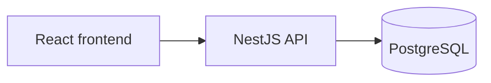

# Kiến trúc ứng dụng

Bản thiết kế, kiến trúc cho ứng dụng, các techstack được sử dụng và nội dung cần lưu ý.

## Tech stack

| Thành phần               | Công nghệ                       |
| -------------------------- | --------------------------------- |
| Frontend                   | React, Vite, TypeScript           |
| Giao diện                 | Tailwind CSS                      |
| Backend                    | NestJS, TypeScript, REST API      |
| Database                   | PostgreSQL                        |
| Truy cập dữ liệu        | Prisma và migration SQL khi cần |
| Xác thực                 | JWT                               |
| Môi trường phát triển | Docker Compose                    |

## Tổng thể

Backend dùng modular monolith: một ứng dụng, chia thành các module nghiệp vụ và dùng chung PostgreSQL. Frontend gọi backend qua REST API.



Frontend kiểm tra dữ liệu để hỗ trợ người dùng. Backend chịu trách nhiệm xác thực, phân quyền và xử lý nghiệp vụ.

## Chia module theo nghiệp vụ

```text
src/
  modules/
    auth/             Đăng nhập, xác thực JWT
    users/            Tài khoản, profile, quản trị tài khoản
    venues/           Venue và các Court thuộc Venue
    bookings/         Đặt sân, hủy sân, xem booking
    staffing/         Tuyển, ứng tuyển, bổ nhiệm và thu hồi Manager
    feedback/         Góp ý cho Venue
    notifications/    Thông báo cho người dùng
```

Role dùng để phân quyền và tách controller khi cần. Nghiệp vụ booking vẫn nằm trong `bookings`, dù người gọi là User, Owner hay Manager. Mỗi module công khai các service cần dùng cho module khác; không gọi trực tiếp Repository triển khai của nhau.

## Bên trong mỗi module

Ví dụ vị trí các file khi triển khai Booking. Khung hiện tại chỉ tạo các thư mục, chưa có file mã nguồn.

```text
bookings/
  bookings.module.ts
  presentation/
    my-bookings.controller.ts
    venue-bookings.controller.ts
    dto/
      create-booking.dto.ts
      cancel-customer-booking.dto.ts
  application/
    bookings.service.ts
  domain/
    booking.ts
    booking.repository.ts
  infrastructure/
    prisma-booking.repository.ts
```

| Phần                               | Trách nhiệm                                                                                                 |
| ----------------------------------- | ------------------------------------------------------------------------------------------------------------- |
| Controller trong `presentation`   | Nhận HTTP request, kiểm tra DTO, gọi Service và trả HTTP response.                                       |
| Service trong `application`       | Điều phối thao tác, kiểm tra quyền trên dữ liệu cụ thể, quản lý transaction và gọi Repository. |
| Domain trong `domain`             | Chứa mô hình, quy tắc nghiệp vụ và interface Repository. Dùng TypeScript thuần.                      |
| Repository trong `infrastructure` | Triển khai interface bằng Prisma, truy vấn database và chuyển đổi dữ liệu.                           |

Luồng xử lý: **Controller → Service → Repository → PostgreSQL**. Service sử dụng Domain để kiểm tra và thực hiện quy tắc nghiệp vụ.

`booking.repository.ts` khai báo `IBookingRepository`. `prisma-booking.repository.ts` triển khai interface này. `bookings.module.ts` đăng ký implementation bằng token `Symbol('BOOKING_REPOSITORY')` để NestJS inject vào Service.

- Controller không gọi Repository hoặc Prisma.
- Service không nhận Request/Response của HTTP và không viết truy vấn Prisma.
- Domain không import NestJS, Prisma hoặc thư viện hạ tầng.
- Repository không quyết định quyền truy cập và không gửi thông báo cho khách.
- Hai controller cá nhân và quản lý Venue dùng chung Service để giữ thống nhất quy tắc booking.

## Dữ liệu chính

Database gồm các bảng `accounts`, `venues`, `courts`, `bookings`, `manager_applications`, `manager_appointments`, `feedback` và `notifications`. Manager là quyền gắn với Venue qua `manager_appointments`, không phải một tài khoản hoặc role riêng. Account, Venue và Court dùng xóa logic; booking và lịch sử bổ nhiệm vẫn được giữ.

ERD, ràng buộc, index và cách xử lý đồng thời ở tầng dữ liệu nằm trong [thiết kế database](DATABASE.md).

## Các luồng cần giữ rõ

**Đặt sân.** Controller nhận Court và khung giờ. Service kiểm tra tài khoản, sân, thời gian và gọi Repository tạo booking. Yêu cầu nghiệp vụ là chỉ một booking được xác nhận khi nhiều người đặt cùng sân, cùng giờ. Baseline có lỗi chủ đích được mô tả ở phần sau.

**Phân quyền.** JWT xác định tài khoản. Backend kiểm tra trạng thái tài khoản và quan hệ sở hữu/bổ nhiệm hiện tại khi truy cập Venue. Không chỉ dựa vào role hoặc danh sách Venue đã lưu trong token. Thu hồi Manager phải chặn quyền quản lý ngay cả khi token còn hạn.

**Xem profile.** User xem chính mình. Owner/Manager xem khách thông qua booking thuộc Venue được quản lý. Chỉ Owner đúng Venue được xem liên hệ ứng viên đã đồng ý chia sẻ và profile Manager đã bổ nhiệm. Admin xem tài khoản qua chức năng quản trị.

**Bổ nhiệm Manager.** Service kiểm tra hồ sơ, sự đồng ý chia sẻ, quyền Owner và Manager hiện tại của Venue. Việc tạo bổ nhiệm và đổi trạng thái hồ sơ phải hoàn tất cùng nhau; hai lần phê duyệt đồng thời không được tạo hai Manager cho một Venue.

**Hủy booking của khách.** Service kiểm tra quyền tại Venue và yêu cầu lý do. Việc cập nhật booking, lưu lý do và ghi nhận yêu cầu thông báo phải nằm trong cùng transaction. `notifications` phụ trách gửi và theo dõi kết quả. Thử lại request không được làm mất lý do ban đầu hoặc gửi thông báo trùng. Kênh gửi và thời hạn hủy của Owner/Manager còn cần chốt.

**Xóa Venue/Court.** Service kiểm tra booking chưa kết thúc trước khi xóa logic. Xóa Venue còn đóng tuyển và thu hồi các bổ nhiệm tại Venue đó. Các thay đổi liên quan phải dùng cùng transaction; cần phối hợp với luồng đặt sân để tránh tạo booking vào sân vừa bị xóa.

## Baseline có lỗi chủ đích (Intentional Defect Hooks)

Để phục vụ mục tiêu môn học Kiến trúc Phần mềm và cung cấp cơ sở đo lường, đánh giá cho các nhóm/giai đoạn phát triển tiếp theo, bản **Baseline** đã được cài đặt có chủ đích **5 điểm nút thắt/khiếm khuyết kiến trúc kinh điển**. Toàn bộ mã nguồn bản Baseline giữ nguyên sự phân tầng nghiêm ngặt (Controller -> Service -> Repository), nhưng cố tình bỏ qua các cơ chế tối ưu hóa, đồng bộ hóa hoặc kiểm soát tải tại các vị trí này.

Mỗi bản cải tiến sau này cần có commit/tag riêng và chạy bộ benchmark kiểm chứng trên cùng một môi trường (ví dụ môi trường Kaggle CPU cố định theo yêu cầu đồ án), dùng chung dữ liệu tải để so sánh các chỉ số: số lỗi phát sinh, tỷ lệ thành công, thời gian phản hồi (P95/P99 latency) và mức tiêu thụ tài nguyên.

---

### HOOK-01: Race Condition Đặt Sân Đồng Thời (Check-Then-Act Concurrency Defect)

- **Vị trí mã nguồn**: src/modules/bookings/application/bookings.service.ts (phương thức createBooking).
- **Bản chất khiếm khuyết**:
  1. Request A kiểm tra sân và thấy trống (isCourtAvailable).
  2. Request B kiểm tra cùng sân con, cùng khung giờ và cũng thấy trống.
  3. Có khoảng trễ bất đồng bộ nhân tạo (async tick / delay 50ms) mô phỏng độ trễ I/O xử lý giữa bước kiểm tra và bước ghi dữ liệu.
  4. Cả hai request cùng gọi save() và đều tạo bản ghi booking với trạng thái CONFIRMED.
  5. Luồng này cố tình không sử dụng khóa bi quan (SELECT FOR UPDATE), khóa phân tán (Distributed Lock), hay mức cô lập Serializable, và CSDL Baseline chưa có ràng buộc loại trừ (EXCLUDE).
- **Hậu quả**: Vi phạm nghiêm trọng quy tắc nghiệp vụ trong PRD: phát sinh tình trạng **đặt trùng sân (double booking)** khi có nhiều khách hàng đặt cùng một sân trong cùng một thời điểm.
- **Cách thức đo lường & tái hiện**:
  - Chạy kịch bản kiểm thử tải đồng thời trong 	est/race-condition-baseline.spec.ts hoặc script benchmark k6: Gửi đồng thời 10–50 requests cho cùng 1 khung giờ của cùng 1 sân con.
  - Ghi nhận: Cả 10–50 requests đều nhận mã HTTP 201 Created và tạo nhiều booking trùng nhau.
- **Gợi ý hướng giải quyết cho nhóm cải tiến**:
  - *Phương án 1 (Ràng buộc CSDL - Khuyến nghị)*: Bổ sung extension tree_gist và ràng buộc loại trừ PostgreSQL trong migration cải tiến:
    `sql
    CREATE EXTENSION IF NOT EXISTS btree_gist;
    ALTER TABLE bookings ADD CONSTRAINT no_overlapping_confirmed_bookings
      EXCLUDE USING gist (court_id WITH =, tstzrange(starts_at, ends_at, \'[)\') WITH &&)
      WHERE (status = \'CONFIRMED\');
    `
    Tầng Service/Repository bắt mã lỗi vi phạm loại trừ 23P01 của PostgreSQL và chuyển đổi thành HTTP 409 Conflict (BOOKING_CONFLICT).
  - *Phương án 2 (Khóa bi quan - Pessimistic Locking)*: Thực hiện truy vấn SELECT ... FROM courts WHERE id = :courtId FOR UPDATE trong một Database Transaction mức Read Committed để tuần tự hóa các yêu cầu đặt trên cùng một sân con.
  - *Phương án 3 (Khóa phân tán - Distributed Lock)*: Sử dụng Redis Redlock với khóa tài nguyên lock:court:{courtId}:{date} kèm thời gian sống (TTL) ngắn để serialize việc kiểm tra và xác nhận đặt sân.

---

### HOOK-02: Vấn Đề Truy Vấn N+1 Trong API Đọc (Read Performance Bottleneck / N+1 Query Loop)

- **Vị trí mã nguồn**: src/modules/venues/application/venues.service.ts (phương thức getVenues và getVenueDetail).
- **Bản chất khiếm khuyết**:
  - Khi lấy danh sách Cụm sân (GET /api/v1/venues), service thực hiện 1 truy vấn lấy danh sách Venues, sau đó dùng vòng lặp or...of trên từng Venue để truy vấn danh sách Courts con ($ truy vấn).
  - Với mỗi Court, mã nguồn tiếp tục truy vấn trạng thái lịch đặt hoặc thông tin Manager ( \times M$ truy vấn).
  - Với $ cụm sân và $ sân con, tổng số truy vấn phát sinh là  + N + (N \times M)$ thay vì gom nhóm dữ liệu.
- **Hậu quả**: Khi dữ liệu mở rộng (ví dụ 50 cụm sân $\times$ 5 sân con = hơn 300 truy vấn I/O), độ trễ phản hồi (P95/P99 latency) tăng vọt, tiêu tốn CPU và chiếm dụng kết nối database connection pool.
- **Cách thức đo lường & tái hiện**:
  - Chạy kịch bản truy vấn danh sách sân với bộ dữ liệu seed mở rộng (20–50 cụm sân).
  - Bật log truy vấn SQL hoặc đếm số lần gọi repository; đo lường thời gian phản hồi (ms) của endpoint /api/v1/venues.
- **Gợi ý hướng giải quyết cho nhóm cải tiến**:
  - *Phương án 1 (Single JOIN Query)*: Viết câu truy vấn gộp sử dụng JOIN / LEFT JOIN giữa bảng enues và courts, kết hợp COUNT(courts.id) và GROUP BY để lấy toàn bộ dữ liệu chỉ trong 1 câu truy vấn SQL duy nhất.
  - *Phương án 2 (Prisma Eager Loading)*: Sử dụng prisma.venue.findMany({ include: { courts: { where: { deletedAt: null } } } }) tận dụng foreign key index đã được đánh sẵn.
  - *Phương án 3 (Cache-Aside với Redis)*: Lưu kết quả danh sách cụm sân vào bộ nhớ đệm Redis với TTL ngắn (5–15 phút), và sử dụng cơ chế vô hiệu hóa cache (Cache Invalidation) khi có thao tác thêm/sửa/xóa sân con.

---

### HOOK-03: Khớp Nối Đồng Bộ Trong Xử Lý Thông Báo Outbox (Synchronous Side-Effect Coupling)

- **Vị trí mã nguồn**: src/modules/bookings/application/bookings.service.ts (cancelCustomerBooking), src/modules/staffing/application/staffing.service.ts (ppointManager) và src/modules/notifications/application/notifications.service.ts (dispatchSync).
- **Bản chất khiếm khuyết**:
  - Mặc dù bảng 
otifications được thiết kế theo mẫu Transactional Outbox (có trạng thái PENDING, SENT, FAILED), luồng Baseline lại thực hiện gửi thông báo đồng bộ (dispatchSync) với độ trễ nhân tạo 800ms (mô phỏng gọi API bên thứ ba như SMS/Email gateway) ngay trong cùng chu trình xử lý HTTP request của Quản lý/Chủ sân.
  - Vi phạm nguyên tắc Decoupling và Single Responsibility: nếu hệ thống gửi thông báo bị chậm hoặc gián đoạn mạng, toàn bộ request hủy sân của Quản lý bị block hoặc timeout, gây ra hiện tượng Cascading Failure.
- **Hậu quả**: Thời gian phản hồi của các thao tác quản lý tăng thêm gần 1 giây một cách không cần thiết; nguy cơ thất bại cả giao dịch nếu bên thứ ba gặp sự cố.
- **Cách thức đo lường & tái hiện**:
  - Đo thời gian phản hồi của API POST /api/v1/venues/{id}/bookings/{id}/cancel.
  - Mô phỏng ngắt kết nối mạng hoặc nâng độ trễ gửi thông báo để quan sát thời gian chờ và tỷ lệ lỗi tại client.
- **Gợi ý hướng giải quyết cho nhóm cải tiến**:
  - *Phương án 1 (Transactional Outbox + Async Background Worker - Khuyến nghị)*: Khi hủy sân hoặc bổ nhiệm, service chỉ ghi một bản ghi thông báo với trạng thái PENDING vào bảng 
otifications trong cùng một database transaction. Trả về kết quả HTTP 200 OK ngay lập tức cho client mà không chờ gửi.
  - *Phương án 2 (Hàng đợi BullMQ / Redis Queue)*: Đẩy message vào hàng đợi Redis (BullMQ). Một Worker tiến trình riêng biệt sẽ nhận job, gọi dịch vụ gửi thông báo và cập nhật trạng thái SENT / FAILED cùng sent_at độc lập với luồng web server.
  - *Phương án 3 (Retry Policy & Dead Letter Queue)*: Xây dựng cơ chế tự động thử lại với Exponential Backoff (ví dụ thử lại 3 lần sau 2s, 4s, 8s) và chuyển thông báo vào hàng đợi lỗi (DLQ) nếu vượt quá số lần thử tối đa (ttempt_count >= max_attempts).

---

### HOOK-04: Thắt Cổ Chai I/O Quyền Hạn Do Truy Vấn CSDL Mỗi Request Mà Không Có Cache (Uncached Dynamic RBAC)

- **Vị trí mã nguồn**: src/common/guards/dynamic-manager.guard.ts và src/modules/staffing/application/staffing.service.ts (isUserActiveManager).
- **Bản chất khiếm khuyết**:
  - Để đảm bảo tính chất Dynamic RBAC (thu hồi quyền Manager có hiệu lực ngay lập tức mà không phụ thuộc vào hạn sống của JWT token), hệ thống không lưu vai trò quản lý cụm sân trong token.
  - Thay vào đó, mỗi request của Manager/Owner đến các endpoint quản trị đều kích hoạt DynamicManagerGuard truy vấn trực tiếp CSDL: SELECT ... FROM manager_appointments WHERE user_id = :userId AND venue_id = :venueId AND revoked_at IS NULL.
  - Việc không có tầng đệm (caching) khiến CSDL phải chịu tải liên tục hàng nghìn câu truy vấn quyền hạn giống hệt nhau khi lưu lượng người dùng quản lý tăng cao.
- **Hậu quả**: Tiêu tốn I/O và kết nối của CSDL cho các thao tác xác thực lặp lại, làm giảm thông lượng (RPS) tối đa của hệ thống.
- **Cách thức đo lường & tái hiện**:
  - Chạy kịch bản load test liên tục trên các endpoint quản lý sân (ví dụ GET /api/v1/venues/{id}/bookings).
  - Đếm tần suất truy vấn tới bảng manager_appointments trên mỗi request thành công.
- **Gợi ý hướng giải quyết cho nhóm cải tiến**:
  - *Phương án 1 (Distributed Cache với Event-Driven Invalidation - Khuyến nghị)*: Lưu trạng thái quyền quản lý vào Redis với key 
bac:manager:{venueId}:{userId} kèm TTL 10–30 phút. Guard sẽ kiểm tra cache trước (Cache-Hit). Khi Owner thực hiện thu hồi quyền Manager (DELETE /venues/{id}/managers/{userId}), hệ thống phát sự kiện xóa ngay lập tức cache key tương ứng (Event-Driven Invalidation), vừa đảm bảo hiệu năng cao vừa bảo toàn tính realtime của việc thu hồi.
  - *Phương án 2 (In-Memory LRU Cache)*: Sử dụng bộ nhớ đệm cục bộ trong tiến trình Node.js với TTL cực ngắn (30–60 giây) cho các kết quả kiểm tra quyền, giúp giảm thiểu đáng kể số lần chạm CSDL.

---

### HOOK-05: Thiếu Cơ Chế Giới Hạn Tần Suất Phân Tán Trên Endpoint Công Khai (Missing Distributed Rate Limiting)

- **Vị trí mã nguồn**: src/modules/auth/presentation/auth.controller.ts (/auth/login, /auth/register) và src/modules/feedback/presentation/feedback.controller.ts (/venues/:id/feedback).
- **Bản chất khiếm khuyết**:
  - Các endpoint công khai không yêu cầu xác thực hoặc cho phép người dùng ẩn danh gửi dữ liệu hiện chưa được tích hợp bộ lọc giới hạn tần suất (Rate Limiter), hoặc chỉ dựa vào bộ nhớ RAM của một tiến trình đơn lẻ.
  - Khi triển khai mở rộng trên nhiều instance/container, bộ đếm in-memory cục bộ không thể đồng bộ trạng thái giới hạn giữa các node.
- **Hậu quả**: Nguy cơ bị tấn công dò quét mật khẩu (Credential Stuffing/Brute-force) tại /auth/login, tạo tài khoản rác hàng loạt tại /auth/register, hoặc gửi spam đánh giá giả mạo gây tràn bộ nhớ tại /venues/{id}/feedback.
- **Cách thức đo lường & tái hiện**:
  - Gửi liên tiếp 1.000 requests đăng nhập sai mật khẩu trong 10 giây từ cùng một IP/client.
  - Quan sát máy chủ tiếp tục xử lý toàn bộ và tiêu tốn CPU cho phép so khớp bcrypt hash mà không hề trả về mã lỗi HTTP 429 Too Many Requests.
- **Gợi ý hướng giải quyết cho nhóm cải tiến**:
  - *Phương án 1 (NestJS Throttler với Redis Storage Engine - Khuyến nghị)*: Tích hợp @nestjs/throttler cùng 	hrottler-storage-redis. Áp dụng thuật toán Sliding Window Counter:
    - /auth/login: Tối đa 5 lần thử / phút trên mỗi IP/Email.
    - /auth/register: Tối đa 3 lần đăng ký / 5 phút trên mỗi IP.
    - /venues/:id/feedback: Tối đa 10 lượt gửi / giờ trên mỗi IP.
    - Trả về mã lỗi HTTP 429 Too Many Requests kèm response header chuẩn Retry-After.
  - *Phương án 2 (Reverse Proxy / Gateway Rate Limiting)*: Cấu hình giới hạn tần suất tại tầng NGINX (limit_req_zone), Cloudflare hoặc Kong API Gateway trước khi request đi vào container NestJS.

---

Phạm vi chức năng và các điểm chưa chốt nằm trong [PRD](../product/PRD.md). Hợp đồng API nằm trong [OpenAPI](../api/openapi.yaml). Cấu trúc mã nguồn này dựa trên [module của NestJS](https://docs.nestjs.com/modules); ràng buộc khoảng thời gian tham khảo [PostgreSQL](https://www.postgresql.org/docs/current/rangetypes.html#RANGETYPES-CONSTRAINT).
