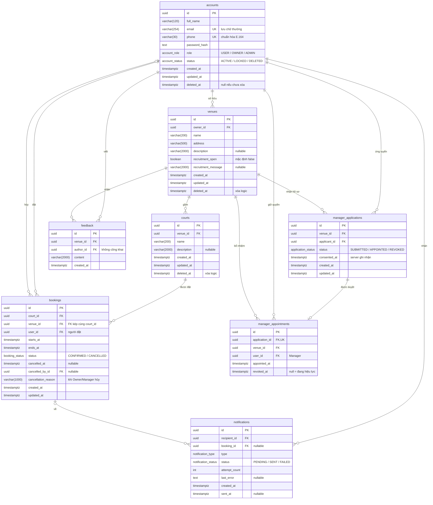

# Thiết kế database

Thiết kế schema PostgreSQL cho MVP. Schema đã được viết bằng Prisma, có migration baseline và dữ liệu mẫu; cách chạy và cách dùng ở mục [Triển khai](#triển-khai). Backend chưa có code sử dụng database.

Nguồn yêu cầu: [PRD](../product/PRD.md), [kiến trúc](ARCHITECTURE.md) và [OpenAPI](../api/openapi.yaml).

## Sơ đồ ERD



## Quy ước chung

- PK là `uuid`, sinh bằng `gen_random_uuid()`.
- Thời gian dùng `timestamptz`.
- Độ dài `varchar` khớp `maxLength` trong OpenAPI.
- Mọi FK dùng `ON DELETE RESTRICT`. Account, Venue và Court chỉ xóa logic nên lịch sử booking, bổ nhiệm và feedback luôn còn tham chiếu.
- Enum `account_role`, `account_status`, `booking_status`, `application_status` dùng đúng giá trị trong OpenAPI. `notification_type` hiện chỉ có `BOOKING_CANCELLED_BY_VENUE`.

## Tài khoản

Mọi người dùng nằm trong bảng `accounts` và phân biệt bằng `role`. Manager không phải role:

| Quyền | Cách xác định |
| --- | --- |
| User | Tài khoản `ACTIVE`, với mọi role |
| Owner của Venue | `venues.owner_id` trỏ tới tài khoản. `role = OWNER` được kiểm tra khi tạo Venue |
| Manager của Venue | Có `manager_appointments` tại Venue đó với `revoked_at IS NULL` |
| Admin | `role = ADMIN`, chỉ tạo bằng seed |

`managedVenueIds` trong `AccountProfile` được truy vấn từ `manager_appointments`, không lưu thành cột.

Trạng thái: `ACTIVE ⇄ LOCKED` do Admin khóa hoặc mở khóa; `ACTIVE/LOCKED → DELETED` không khôi phục. Mỗi request cần xác thực đọc `status` và bổ nhiệm hiện tại từ database, không dựa vào nội dung JWT.

Email và số điện thoại không được dùng lại, kể cả khi tài khoản đã xóa. Đăng ký trùng trả 409; Admin vẫn tìm được tài khoản `DELETED` theo email. Tầng ứng dụng chuẩn hóa trước khi lưu và so sánh:

- Email: bỏ khoảng trắng đầu cuối, chuyển chữ thường.
- Số điện thoại: chuyển sang E.164 với vùng mặc định VN, ví dụ `0901234567` và `090 123 4567` đều lưu thành `+84901234567`.

## Ràng buộc và index

| Bảng | Ràng buộc hoặc index | Mục đích |
| --- | --- | --- |
| accounts | `UNIQUE(email)`, `CHECK(email = lower(email))` | Email không trùng, không phân biệt hoa thường |
| accounts | `UNIQUE(phone)` | Số điện thoại không trùng |
| accounts | `CHECK((status = 'DELETED') = (deleted_at IS NOT NULL))` | Trạng thái và thời điểm xóa luôn khớp |
| venues | index `(owner_id) WHERE deleted_at IS NULL` | Venue của Owner, kiểm tra quyền sở hữu |
| courts | `UNIQUE(id, venue_id)` | Đích của FK kép từ `bookings` |
| courts | index `(venue_id) WHERE deleted_at IS NULL` | Danh sách Court của Venue |
| bookings | `FOREIGN KEY (court_id, venue_id) REFERENCES courts(id, venue_id)` | `venue_id` luôn đúng Venue của Court |
| bookings | `CHECK(ends_at > starts_at)` | Giờ kết thúc sau giờ bắt đầu |
| bookings | `CONFIRMED`: `cancelled_at`, `cancelled_by_id`, `cancellation_reason` đều NULL. `CANCELLED`: `cancelled_at`, `cancelled_by_id` NOT NULL | Trạng thái và dữ liệu hủy nhất quán |
| bookings | `CHECK(status <> 'CANCELLED' OR cancelled_by_id = user_id OR cancellation_reason IS NOT NULL)` | Hủy booking của khách bắt buộc có lý do |
| bookings | `CHECK(cancellation_reason IS NULL OR btrim(cancellation_reason) <> '')` | Lý do hủy không chỉ có khoảng trắng |
| bookings | index `(court_id, starts_at)`, `(venue_id, starts_at)`, `(user_id, starts_at)` | Kiểm tra sân trống, booking của Venue, booking cá nhân |
| bookings | Bản cải tiến: `EXCLUDE USING gist (court_id WITH =, tstzrange(starts_at, ends_at, '[)') WITH &&) WHERE (status = 'CONFIRMED')` | Không đặt trùng giờ; `[)` cho phép hai booking liền nhau |
| manager_applications | `UNIQUE(venue_id, applicant_id) WHERE status IN ('SUBMITTED', 'APPOINTED')` | Mỗi User một hồ sơ còn hiệu lực tại một Venue; hồ sơ `REVOKED` không chặn ứng tuyển lại |
| manager_appointments | `UNIQUE(application_id)` | Một hồ sơ chỉ tạo một bổ nhiệm |
| manager_appointments | `UNIQUE(venue_id) WHERE revoked_at IS NULL` | Mỗi Venue tối đa một Manager |
| manager_appointments | index `(user_id) WHERE revoked_at IS NULL` | `managedVenueIds` và kiểm tra quyền Manager |
| manager_appointments | `CHECK(revoked_at IS NULL OR revoked_at >= appointed_at)` | Không thu hồi trước khi bổ nhiệm |
| feedback | `CHECK(btrim(content) <> '')` | Feedback không rỗng |
| feedback | index `(venue_id, created_at DESC)` | Danh sách feedback của Venue |
| notifications | `UNIQUE(type, booking_id)` | Thử lại request hủy không tạo thông báo trùng |
| notifications | `CHECK(attempt_count >= 0)`, `CHECK((status = 'SENT') = (sent_at IS NOT NULL))` | Số lần gửi và trạng thái gửi nhất quán |
| notifications | index `(created_at) WHERE status = 'PENDING'` | Lấy thông báo chờ gửi |

## Quyết định thiết kế

- **Thông tin tuyển Manager nằm trong `venues`.** Mỗi Venue có một thông báo tuyển và không cần lịch sử, nên không tách bảng.
- **`bookings` lưu thêm `venue_id`.** API trả `venueId` và các API quản lý lọc booking theo Venue. Court không đổi Venue; FK kép `(court_id, venue_id)` giữ giá trị luôn đúng.
- **Hồ sơ ứng tuyển và bổ nhiệm là hai bảng.** Quyền Manager chỉ đọc từ `manager_appointments`. Tạo hoặc thu hồi bổ nhiệm và đổi `status` của hồ sơ nằm trong cùng transaction.
- **Không có cột `consent_to_share_contact`.** API chỉ nhận giá trị `true`; `consented_at NOT NULL` là bằng chứng đồng ý và API trả `consentToShareContact: true`.
- **Không lưu bản sao liên hệ của ứng viên.** Owner xem tên, email và số điện thoại hiện tại trong `accounts`.
- **`bookings.cancelled_by_id` ghi người hủy.** Cột này phân biệt User tự hủy với Owner/Manager hủy booking của khách.
- **`notifications` là outbox.** Hủy booking của khách cập nhật `bookings` và thêm `notifications` trong cùng transaction. Module `notifications` gửi và cập nhật `status`, `attempt_count`, `sent_at`. Lý do hủy đọc từ `bookings.cancellation_reason`.
- **Không có bảng session.** Khóa, xóa tài khoản hoặc thu hồi Manager có hiệu lực ngay vì mỗi request đọc trạng thái hiện tại từ database.

## Đồng thời và baseline có lỗi chủ đích

**Đặt trùng giờ.** Migration baseline không có `EXCLUDE` để giữ lỗi race condition chủ đích mô tả trong [kiến trúc](ARCHITECTURE.md#baseline-có-lỗi-chủ-đích). Bản cải tiến thêm migration SQL riêng gồm `CREATE EXTENSION btree_gist` và ràng buộc `EXCLUDE`. Service bắt lỗi `23P01` và trả 409 `BOOKING_CONFLICT`.

**Đặt sân khi đang xóa Court/Venue.** Transaction đặt sân khóa Court bằng `SELECT ... WHERE id = $1 AND deleted_at IS NULL FOR SHARE`. Transaction xóa khóa các Court liên quan bằng `FOR UPDATE`, kiểm tra không còn booking `CONFIRMED` có `ends_at > now()` rồi mới xóa logic. Hai lượt đặt sân cùng giữ `FOR SHARE` không chặn nhau, nên baseline vẫn tái hiện được lỗi đặt trùng.

**Duyệt hai hồ sơ cùng lúc.** Partial unique index trên `manager_appointments(venue_id)` chỉ cho một bổ nhiệm đang hiệu lực; request còn lại nhận lỗi `23505` và trả 409 `APPOINTMENT_CONFLICT`. Service khóa hồ sơ bằng `FOR UPDATE` trước khi kiểm tra trạng thái `SUBMITTED`.

**Hủy booking lặp lại.** Dùng `UPDATE ... WHERE id = $1 AND status = 'CONFIRMED' RETURNING *`. Không có dòng nào được cập nhật thì trả booking hiện tại; thông báo dùng `INSERT ... ON CONFLICT DO NOTHING`.

## Quy tắc ở tầng ứng dụng

Các quy tắc sau không thể hiện bằng ràng buộc schema và do Service kiểm tra:

- `starts_at` ở tương lai; User chỉ hủy khi còn ít nhất 30 phút trước giờ bắt đầu.
- Chỉ tài khoản `role = OWNER` được tạo Venue.
- Chỉ ứng tuyển khi `recruitment_open = true`; ứng viên phải `ACTIVE` khi được bổ nhiệm.
- Xóa Venue trong một transaction: xóa logic các Court, đóng tuyển, thu hồi bổ nhiệm và chuyển hồ sơ `APPOINTED` thành `REVOKED`.
- Quyền xem profile theo booking, hồ sơ ứng tuyển và bổ nhiệm như mô tả trong PRD.

## Điểm chưa chốt

| Nội dung | Thay đổi dự kiến khi chốt |
| --- | --- |
| Rating, quyền sửa và xóa feedback | Thêm `feedback.rating`, `updated_at`, `deleted_at`; có thể gắn `booking_id` |
| Kênh gửi thông báo | Thêm `notifications.channel` và `next_attempt_at` |
| Giờ mở cửa, độ dài lượt đặt | Thêm bảng giờ mở cửa theo Venue hoặc Court; MVP cho chọn giờ tự do |
| Admin xóa tài khoản Owner | Không cần đổi schema; cần chốt cách xử lý Venue và bổ nhiệm |

## Triển khai

| File | Nội dung |
| --- | --- |
| `prisma/schema.prisma` | Model, enum, FK và index, gồm cả partial index |
| `prisma/migrations/20261018000000_baseline/` | Migration baseline: bảng, index và CHECK constraint |
| `prisma/seed.ts` | Dữ liệu mẫu, chạy lại nhiều lần không tạo bản ghi trùng |
| `prisma.config.ts` | Cấu hình Prisma CLI: đường dẫn schema, migration, lệnh seed và `DATABASE_URL` |
| `docker-compose.yml` | Service `postgres` (PostgreSQL 17) và `db-init` cho môi trường local |
| `.env.example` | Mẫu biến môi trường, chỉ chứa giá trị giữ chỗ. File `.env` thật gửi riêng trong nhóm, không commit |
| `docker/db-init.Dockerfile` | Image của `db-init`: chạy `prisma migrate deploy` rồi seed, xong thì thoát |

Dùng Prisma 7.10.1. Model đặt tên PascalCase, ánh xạ sang bảng snake_case bằng `@@map`.

### Chạy database local

Giá trị thật của `.env` được gửi riêng trong nhóm; `.env.example` chỉ chứa giá trị giữ chỗ vì repo public. Đặt `.env` vào thư mục gốc (hoặc copy `.env.example` rồi điền), sau đó:

```bash
docker compose up -d
```

`postgres` chạy ở cổng `POSTGRES_PORT` (mặc định 5432). `db-init` đợi `postgres` sẵn sàng, áp dụng migration, seed rồi thoát; xem kết quả bằng `docker compose logs db-init`. Mỗi lần `docker compose up`, `db-init` chạy lại: migration đã áp dụng được bỏ qua, seed ghi đè các bản ghi mẫu về giá trị ban đầu. Sau khi thêm migration mới, chạy `docker compose up -d --build` để image nhận file mới.

Xóa toàn bộ dữ liệu và tạo lại từ đầu bằng `docker compose down -v` rồi `docker compose up -d`.

Khi viết code backend hoặc sửa schema, cài thêm trên máy:

```bash
npm install
npm run db:generate
```

`npm run db:migrate` tạo migration mới khi sửa schema. Prisma 7 không tự chạy seed sau khi migrate hoặc reset, nên phải chạy `npm run db:seed` riêng.

### Quy ước khi sửa schema

- Partial index khai báo trong schema bằng `where: raw(...)` (preview `partialIndexes`). Điều kiện phải viết đúng dạng PostgreSQL lưu lại. Ví dụ `status IN ('A', 'B')` được lưu thành `status = ANY (ARRAY['A'::kiểu_enum, 'B'::kiểu_enum])`; nếu viết khác, Prisma coi là lệch schema và tạo lại index ở mỗi migration.
- CHECK và EXCLUDE không khai báo được trong schema. Tạo migration bằng `npx prisma migrate dev --create-only`, thêm SQL vào cuối `migration.sql` rồi mới chạy `npm run db:migrate`.
- Ràng buộc `EXCLUDE` chống đặt trùng giờ chỉ thêm ở migration của bản cải tiến.
- Kiểm tra schema khớp database bằng `npx prisma migrate diff --from-config-datasource --to-schema prisma/schema.prisma --exit-code`; mã thoát 0 là khớp.

### Dữ liệu mẫu

Mọi tài khoản mẫu dùng chung mật khẩu `SEED_PASSWORD` trong `.env`. Mật khẩu được hash bằng bcrypt, nên backend kiểm tra đăng nhập bằng thư viện tương thích bcrypt.

| Email | Vai trò | Dùng để thử |
| --- | --- | --- |
| `admin@example.com` | ADMIN | Quản trị tài khoản |
| `owner.anphu@example.com` | OWNER | Sở hữu An Phú (đang tuyển Manager) và Thảo Điền |
| `owner.thuduc@example.com` | OWNER | Sở hữu Thủ Đức |
| `manager.minh@example.com` | USER | Manager đang quản lý An Phú, có booking cá nhân |
| `user.lan@example.com` | USER | Có booking và hồ sơ ứng tuyển SUBMITTED tại An Phú |
| `user.huy@example.com` | USER | Có booking bị Venue hủy kèm thông báo; từng là Manager Thảo Điền và đã bị thu hồi |
| `user.locked@example.com` | USER | Tài khoản LOCKED |
| `user.deleted@example.com` | USER | Tài khoản DELETED |

Thời gian booking tính theo ngày chạy seed (giờ Việt Nam), nên luôn có booking sắp tới, booking đã diễn ra và booking đã hủy. Thảo Điền có một Court đã xóa logic.

### Dùng trong backend

Client được sinh vào `src/generated/prisma` (không commit) dưới dạng CommonJS cho NestJS. Prisma 7 bắt buộc dùng driver adapter:

```ts
import { PrismaPg } from '@prisma/adapter-pg';
import { PrismaClient } from '../generated/prisma/client';

const prisma = new PrismaClient({
  adapter: new PrismaPg({ connectionString: process.env.DATABASE_URL, options: '-c TimeZone=UTC' }),
});
```

Đổi đường dẫn import theo vị trí file. Phải giữ `options: '-c TimeZone=UTC'`: adapter gửi thời gian dạng UTC nhưng không kèm múi giờ, nên nếu server PostgreSQL đặt múi giờ Việt Nam thì mọi giá trị thời gian bị lưu lệch 7 giờ mà không báo lỗi. `DATABASE_URL` trong `.env` cũng phải có tham số này cho Prisma CLI, như trong `.env.example`.

Lỗi khi vi phạm ràng buộc:

| Vi phạm | Mã Prisma | Tên constraint |
| --- | --- | --- |
| Unique, kể cả partial unique | `P2002` | `error.meta.driverAdapterError.cause.constraint.index` |
| Foreign key | `P2003` | `error.meta.driverAdapterError.cause.constraint.index` |
| CHECK | `P2039` | Trong `error.meta.driverAdapterError.cause.originalMessage` |

Dựa vào tên constraint để trả đúng mã lỗi API, ví dụ `manager_appointments_venue_id_key` thành 409 `APPOINTMENT_CONFLICT`.
