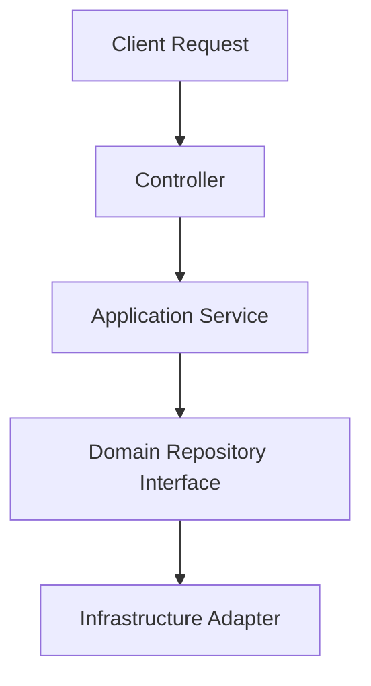

# Draft Proposal: Proposed Concept

## 1. Problem Statement & Motivation
<!-- What architectural bottleneck or functional requirement does this address? -->

## 2. Proposed Architecture / Design
<!-- Detailed description, module changes, interface signatures -->

## 3. Alternatives Evaluated
<!-- What other ways could this be done, and why is this proposal preferable? -->

## 4. Risks, Trade-offs & University Constraints
<!-- Does this adhere to the university assignment layered constraints? -->

## 5. Promotion Checklist
- [ ] Reviewed with team lead / peer
- [ ] Moved to `documentation/03_architecture/` or relevant team folder
- [ ] Metadata changed to `visibility: team`
- [ ] Validated with `npm run docs:validate`
